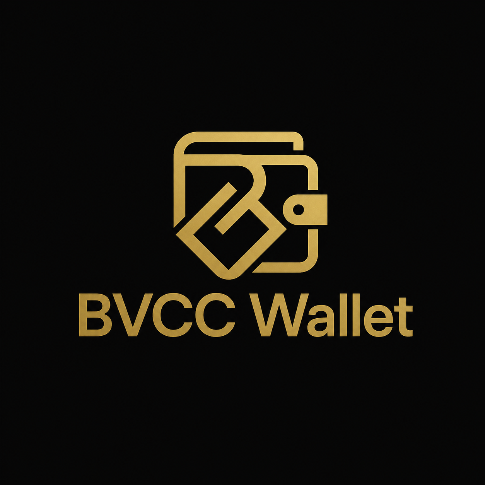

<p align="center">
  
</p>

<p align="center">
  <a href="https://glama.ai/mcp/servers/blockventurechaincapital-crypto/bvcc-agent-mcp">
    
  </a>
</p>

# @bvcc/agent-mcp

**Model Context Protocol server for a BVCC Agent Wallet.** It lets MCP-speaking
AI runtimes — Claude Code, Cursor, the Claude desktop app — operate a BVCC Agent
Wallet on-chain: check balances and limits, plan and simulate swaps, send tokens,
swap on Uniswap v3/v4 (including to and from native ETH), **provide liquidity on
Uniswap v3/v4** (including native-ETH pools), and **lend, borrow and unwind
positions on Aave v3** — including closing or deleveraging a position in safe
steps on its own. It also ships built-in **operating guides** (`listGuides` /
`getGuide`, also exposed as prompts) so an agent can learn how to use each area on
demand.

Every tool is generated from the [`@bvcc/agent-sdk`](https://www.npmjs.com/package/@bvcc/agent-sdk) capability
catalog. There is no per-tool code here: add a capability to the SDK catalog and
it appears here automatically.

> **New here? Start with [QUICKSTART.md](https://github.com/blockventurechaincapital-crypto/bvcc-agent-mcp/blob/main/QUICKSTART.md)** — the full end-to-end
> setup (create wallet → authorize the agent on-chain → fund it with gas → configure
> → verify). It covers the two steps people miss without which the agent does nothing.

## Security

This server **adds no powers**. All limits — spend caps (native + per-token,
daily + total), allowed tokens, allowed protocols, recipient whitelist, and a
global pause — are enforced **on-chain** by the Agent Wallet contract. The worst
any tool can do is bounded by what you authorized for the agent in the BVCC
dashboard.

- The agent's **private key** is read from the environment, used locally to sign,
  and **never transmitted**. BVCC does not receive, store, or custody it.
- Tools are exposed **explicitly** via the SDK catalog — nothing is auto-discovered.
- Set `BVCC_MCP_READONLY=true` to expose only read/simulate tools (no writes).

## Tools

Generated from the catalog and tagged by class:

**Core** (wallet, transfers, swaps):

| Class | Tools |
|-------|-------|
| 🟢 read | `getAgentStatus`, `getCapabilities`, `getNativeBalance`, `getTokenBalances`, `getRemaining`, `needsApproval` |
| 🟡 simulate | `buildSwapPlan`, `dryRunSendNative`, `dryRunSendToken`, `dryRunSwapV3`, `dryRunSwapV4` |
| 🔴 write | `sendNative`, `sendToken`, `approve`, `swapV3`, `swapV4`, `swapToNative`, `swapFromNative` |

A 0.15% BVCC agent fee is charged automatically on-chain on agent actions, separate
from gas and from your spend budget.

**Aave v3 lending** (`aave` module — Arbitrum, Ethereum, BNB, Base, Polygon):

| Class | Tools |
|-------|-------|
| 🟢 read | `getAavePositions`, `getAaveMarket` |
| 🟡 simulate | `dryRunAaveSupply`, `dryRunAaveBorrow`, `aavePlanClosePosition`, `aavePlanDeleverage`, `aavePlanCollateralSwap`, `aavePlanDebtSwap` |
| 🔴 write | `aaveSupply`, `aaveWithdraw`, `aaveBorrow`, `aaveRepay`, `aaveRepayWithATokens`, `aaveSetCollateral`, `aaveSetEMode`, `aaveClosePosition`, `aaveDeleverage`, `aaveCollateralSwap`, `aaveDebtSwap` |

Deposits and borrows are always **for the wallet itself** — no `to` or `onBehalfOf`
parameter exists, because the wallet's on-chain call policies pin the beneficiary.

⚠️ **The four `aave*` unwinding tools can send several transactions in one call.**
`aaveClosePosition`, `aaveDeleverage`, `aaveCollateralSwap` and `aaveDebtSwap` run a
chunked loop, re-deriving and re-simulating each step from live state. Call the
matching `aavePlan*` tool first to see what it intends to do. They stop rather than
proceed if the health factor would fall below `hfFloor` (default 1.05), if a swap
prices too far from the Aave oracle, if the loop stops making progress, or if the
agent's budget would run out.

**Uniswap liquidity** (`lp` module — open, collect, close positions on v3 & v4):

| Class | Tools |
|-------|-------|
| 🟢 read | `getV3Position`, `getV4Position` |
| 🟡 simulate | `dryRunAddLiquidityV3`, `dryRunRemoveLiquidityV3`, `dryRunAddLiquidityV4`, `dryRunRemoveLiquidityV4` |
| 🔴 write | `addLiquidityV3`, `removeLiquidityV3`, `collectFeesV3`, `burnV3`, `addLiquidityV4`, `removeLiquidityV4`, `collectFeesV4`, `burnV4` |

The position NFT is minted **to the wallet** and every proceed returns to it —
pinned on-chain. `addLiquidityV3` sizes both sides to the pool's current price
(full-range by default, or pass ticks). v4 covers **native-ETH pools**; its tools
need the v4 PositionManager's DEEP validator active on-chain for the agent, else
the action fails closed. Note there is no `increaseLiquidity` on v3 (not
owner-gated on the NFPM — add by minting a fresh position).

**Guides** (`meta` module — always exposed, help):

| Class | Tools |
|-------|-------|
| 🟢 read | `listGuides`, `getGuide` |

`listGuides` names the how-to guides; `getGuide({ area })` returns the playbook for
one area — the recommended workflow and the gotchas, naming the exact tools —
covering `getting-started`, `swaps`, `lending` and `liquidity`. They stay available
even under a module filter, so an agent restricted to one feature can still learn
how to use it. The same guides are also exposed as **prompts** (`guide-<area>`) so a
human can pull one as a slash-command.

Writes carry the MCP `destructiveHint` annotation so clients can require
confirmation. See [GUIDE.md](https://github.com/blockventurechaincapital-crypto/bvcc-agent-mcp/blob/main/GUIDE.md) for the recommended operating workflow.

## Wallet V5

The server works with every wallet generation and detects which one it is talking to.
On a **V5** wallet a few things change, and the tools already apply them:

- **Limits:** `0` allows nothing (before V5 it meant unlimited) and an empty recipient
  list allows no recipient. Limits count the 0.15% agent fee too, so stay a little under
  them; `getRemaining` shows the real headroom.
- **Swaps** run through the Universal Router, between ERC-20 tokens. `swapV3` keeps
  working: on V5 it is sent through the Universal Router for you.
- **Permit2** allowances for swaps and v4 liquidity are granted by the wallet owner when
  authorizing or renewing the agent, not by the agent.
- **Native coin and Uniswap v3 liquidity** (wrap / unwrap, `swapToNative`,
  `swapFromNative`, the v3 LP tools) work where their validators are active on that
  network; `getCapabilities` says so. Elsewhere use WETH and v4 liquidity.
- **Aave:** everything except `aaveRepayWithATokens`.
- The owner can **pause** one agent, **block** a contract for every agent and **renew**
  the expiry. `getAgentStatus` and `getCapabilities` report all of it.

Anything V5 does not allow comes back as a failed result with a plain explanation,
before any gas is spent.

## Good to know

- **Retry or not.** Every failed result carries `retryable`. When it is `false` the same
  call will fail again (a budget is used up, a permission is missing, the balance is
  short): change the input or ask the owner instead of repeating it.
- **Liquidity ranges as prices.** The LP tools take `priceLower` / `priceUpper` instead
  of raw ticks. A range that does not contain the current price needs a confirmation:
  the first call stops and asks, and `allowOutOfRange: true` opens it.
- **Gas margin.** Transactions are sent with 20% more gas than the estimate; unused gas
  is not paid.
- **Source tag.** Each transaction ends with 8 bytes naming the tool that built it (the
  BVCC MCP) and its version, so BVCC can tell which releases are in use and tie failures
  to a version. It carries nothing about you, your wallet or your agent, and the wallet
  ignores it.

## Configuration

**Recommended:** keep the values — above all `AGENT_PRIVATE_KEY` — in a dedicated
env file and point the server at it with `BVCC_ENV_FILE`, instead of inlining the
key in your MCP host's config (which gets shared, synced and screenshotted).
`chmod 600` that file and keep it outside any cloud-synced folder. You *can* still
inline the variables in the host's `env` block if you prefer; host env wins over
the file. See [`.env.example`](https://github.com/blockventurechaincapital-crypto/bvcc-agent-mcp/blob/main/.env.example).

Example `agent.env` (path passed via `BVCC_ENV_FILE`):

```bash
AGENT_PRIVATE_KEY=0xYOUR_AGENT_KEY
WALLET_ADDRESS=0xYOUR_WALLET
CHAIN_ID=42161
```

| Variable | Required | Description |
|----------|----------|-------------|
| `AGENT_PRIVATE_KEY` | yes | Agent EOA private key (`0x` + 64 hex). Used locally only. |
| `WALLET_ADDRESS` | yes | The BVCC Agent Wallet this agent operates. |
| `CHAIN_ID` | yes | **Default** chain: `42161` Arbitrum One · `56` BNB · `1` Ethereum · `8453` Base · `137` Polygon · `421614` Arbitrum Sepolia. |
| `RPC_URL` | no | Custom RPC for the default chain (otherwise a public default). |
| `RPC_URL_<chainId>` | no | Per-chain RPC override, e.g. `RPC_URL_56`. |
| `BVCC_ENV_FILE` | no | Path to a dedicated env file to load (keeps the key out of the host config). Host env wins over it. |
| `BVCC_MCP_READONLY` | no | `true` exposes only read/simulate tools. |
| `BVCC_MCP_MODULES` | no | Comma-separated feature groups to expose: `core`, `aave`, `lp`. Unset = all. |
| `BVCC_NO_UPDATE_CHECK` | no | `1` turns off the new-version check (see [Upgrading](#upgrading)). |

**Narrowing what the agent can reach.** `BVCC_MCP_READONLY` and `BVCC_MCP_MODULES`
are independent and combine. If an agent will never touch lending, leaving those
tools out is one less thing it can get wrong:

```bash
BVCC_MCP_MODULES=core              # wallet + swaps    (18 + 2 guides = 20)
BVCC_MCP_MODULES=aave              # Aave lending      (19 + 2 = 21)
BVCC_MCP_MODULES=lp                # Uniswap liquidity (14 + 2 = 16)
BVCC_MCP_MODULES=core,aave,lp      # everything (= unset)  (51 + 2 = 53)
BVCC_MCP_MODULES=core
BVCC_MCP_READONLY=true             # read-only wallet  (11 + 2 = 13)
```

The two guide tools (`listGuides`, `getGuide`, module `meta`) are always exposed on
top of these — that is the `+ 2` — so an agent restricted to one feature can still
read how to use it.

An unrecognised module name is ignored, so a typo yields a *smaller* surface, never
a larger one. Neither switch is the security boundary — the contract is — but a
smaller surface is fewer ways for a confused agent to act.

**Multi-network:** one server operates the agent on any supported chain. Every
tool takes an optional `network` (chain id or name: `ethereum`, `bsc`, `arbitrum`,
`base`, `polygon`, `arbitrum-sepolia`), defaulting to `CHAIN_ID` — so you can say "swap on
bsc" without restarting. The wallet address is the same on every chain (CREATE2);
the agent must be authorized on each chain you use.

## Install & build

```bash
npm install
npm run build
npm test          # builds + stdio smoke test (no chain calls)
```

## Connect to a client

### Claude Code

```bash
claude mcp add bvcc-agent-wallet \
  --env BVCC_ENV_FILE=/secure/agent.env \
  -- npx -y @bvcc/agent-mcp@latest
```

### Cursor / Claude app (`mcp.json`)

```json
{
  "mcpServers": {
    "bvcc-agent-wallet": {
      "command": "npx",
      "args": ["-y", "@bvcc/agent-mcp@latest"],
      "env": { "BVCC_ENV_FILE": "/secure/agent.env" }
    }
  }
}
```

The key lives in `agent.env`, not in the config above. If you'd rather inline it,
replace the `env` block with `AGENT_PRIVATE_KEY` / `WALLET_ADDRESS` / `CHAIN_ID`
directly (less safe — the key sits in the host config). `@latest` keeps you on the
newest release; to stay on one version instead, see [Upgrading](#upgrading).

## Upgrading

The SDK is bundled into this package, so **updating the MCP is all you need** to get
new capabilities (Aave lending shipped this way in 0.2.0) — you never install or update
`@bvcc/agent-sdk` separately.

1. **Use `@latest`** (recommended), as in the examples above. `npx` caches, so a
   plain `@bvcc/agent-mcp` with no tag can keep running an old build; `@latest` checks
   for a newer one each time the client starts the server.
   To stay on one version instead, pin it and bump the number yourself when you upgrade:
   ```json
   "args": ["-y", "@bvcc/agent-mcp@0.3.1"]
   ```
   Global installs: `npm i -g @bvcc/agent-mcp@latest`.
2. **Restart your MCP client.** New tools from the catalog appear automatically;
   nothing else in the config changes. The startup banner prints the running
   version (`[bvcc-agent-mcp vX.Y.Z]`).
3. ⚠️ **Authorize any new protocol on-chain.** A release that adds a new protocol
   (e.g. Aave) exposes its tools immediately, but the agent must have that
   protocol's contract in its `allowedProtocols` — otherwise the action reverts
   with `ProtocolNotAllowed`. Authorize it from the dashboard, same as a router.

**Knowing when there is a new version.** When the server starts, it asks the public npm
registry which version of `@bvcc/agent-mcp` is the latest. This runs in the background
and gives up after 2 seconds, so startup never waits on it or fails because of it. If a
newer version is out, the log prints `[bvcc-agent-mcp] update available 0.3.1 → 0.3.2 …`
and `getAgentStatus` returns `updateAvailable: { current, latest, command, changelogUrl }`,
which the agent passes on to you once. The request carries nothing about you, your wallet
or your agent, though npm does see your IP address, the same as with any `npm install`.
To turn it off, set `BVCC_NO_UPDATE_CHECK=1`.

See [CHANGELOG.md](https://github.com/blockventurechaincapital-crypto/bvcc-agent-mcp/blob/main/CHANGELOG.md) for what each version changes. Versioning follows
SemVer: patch = fix, minor = new compatible feature, and `0.x` means the API may
still change.

## How it works

```
@bvcc/agent-sdk  ──catalog──►  @bvcc/agent-mcp  ──MCP──►  Claude Code / Cursor / Claude
   (on-chain limits live in the Agent Wallet contract, not here)
```

The server loads the catalog, registers one MCP tool per capability (Zod schema →
tool input schema, `kind` → tool annotations), and routes each call to the SDK,
which signs with the agent key and submits `executeAsAgent`.

## License

MIT © BlockVenture Chain Capital (BVCC)
